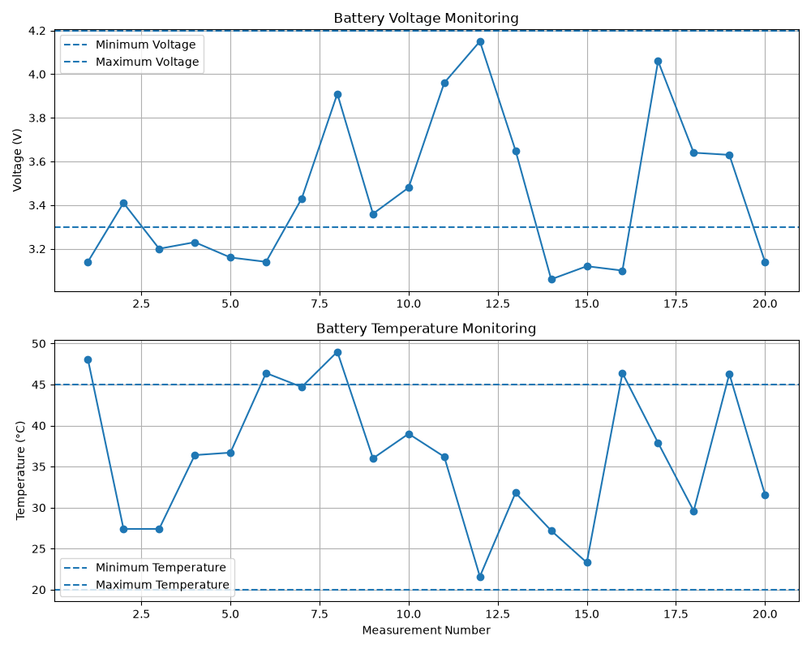

# Hardware Validation Project

## 1. Project Overview

Python을 활용하여 센서 데이터를 수집하고, 전압 및 온도 기준에 따라 데이터의 정상 여부를 검증하는 하드웨어 검증 프로젝트입니다.

센서 데이터의 이상을 감지하고, 테스트 결과를 기록·분석하는 과정을 구현했습니다.

## 2. Project Objectives

- 센서 데이터의 정상 범위 검증
- 전압 및 온도 이상 상태 감지
- PASS / FAIL 기반 테스트 결과 판정
- CSV 파일을 활용한 테스트 데이터 관리
- 테스트 결과 분석 및 시각화
- 자동화된 테스트 케이스 구현

## 3. Development Environment

| Category | Technology |
|---|---|
| Language | Python 3.15 |
| Data Processing | NumPy, Pandas |
| Visualization | Matplotlib |
| Test Framework | Pytest |
| Development Tool | Visual Studio Code |
| Version Control | Git, GitHub |

## 4. Main Features

### 4.1 Sensor Data Validation

센서 전압 및 온도 데이터를 기준 범위와 비교하여 정상 여부를 판단합니다.

| Measurement | Minimum | Maximum |
|---|---:|---:|
| Voltage | 3.3 V | 4.2 V |
| Temperature | 20 °C | 45 °C |

검증 결과에 따라 PASS 또는 FAIL을 반환하고, 이상 항목을 기록합니다.

### 4.2 Test Data Logging

테스트 결과를 CSV 파일로 저장합니다.

- Timestamp
- Voltage
- Temperature
- Test Result
- Error Message

### 4.3 Data Analysis

Pandas를 활용하여 다음 항목을 분석합니다.

- 전체 테스트 횟수
- PASS / FAIL 횟수
- PASS 비율
- 평균 전압
- 평균 온도

### 4.4 Data Visualization

Matplotlib을 활용하여 센서 측정값과 기준 범위를 그래프로 표현합니다.

### 4.5 Automated Testing

Pytest를 활용하여 총 5개의 테스트 케이스를 구현하고 검증했습니다.

## 5. Project Structure

```text
hardware-validation/
├── README.md
├── requirements.txt
├── src/
│   ├── main.py
│   ├── analyze.py
│   ├── visualize.py
│   └── report.py
├── tests/
│   └── test_sensor.py
├── logs/
└── reports/
```

## 6. How to Run

### Install Dependencies

```bash
pip install -r requirements.txt
```

### Run Sensor Validation

```bash
python src/main.py
```

### Analyze Test Data

```bash
python src/analyze.py
```

### Visualize Test Results

```bash
python src/visualize.py
```

### Generate Validation Report

```bash
python src/report.py
```

### Run Automated Tests

```bash
python -m pytest -v
```

## 7. Test Results

Pytest를 이용하여 총 5개의 테스트 케이스를 실행했으며, 모든 테스트가 통과했습니다.

| Test Case | Expected Result |
|---|---|
| Normal sensor data | PASS |
| Low voltage | FAIL |
| High voltage | FAIL |
| High temperature | FAIL |
| Multiple abnormal conditions | FAIL |

## 8. Expected Outcomes

본 프로젝트를 통해 다음과 같은 하드웨어 검증 관련 역량을 실습했습니다.

- 센서 데이터 기반 검증 로직 구현
- 테스트 결과 수집 및 로그 관리
- 데이터 분석 및 시각화
- 테스트 케이스 설계 및 자동화
- 검증 결과 리포트 생성

## 9. Visualization Result

The following graph shows the sensor voltage and temperature measurements with their validation thresholds.



---

**Project Category:** Hardware Validation / System Test

**Language:** Python

## 9. Visualization Result

The following graph shows the sensor voltage and temperature measurements with their validation thresholds.


